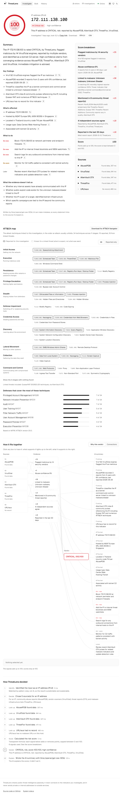

# ThreatLens

[](https://github.com/ashwinruke/threatlens/actions/workflows/ci.yml)

**See the threat before it sees you.**

ThreatLens is an explainable AI threat intelligence agent. Give it a CVE, IP address, domain, file hash, threat group or software weakness. It then:

- checks up to five trusted intelligence sources at once
- scores the risk with a formula you can inspect
- sends a small AI research agent to follow the leads
- explains what to do, with a cited source behind every statement

Every decision it makes is shown: as a step-by-step trail, as a map from evidence to verdict, and as an ATT&CK map of the attack techniques involved.

**Live demo: [threatlens-xi.vercel.app](https://threatlens-xi.vercel.app)** · **API docs: [threatlens-api-fyjy.onrender.com/docs](https://threatlens-api-fyjy.onrender.com/docs)**

> The backend runs on a free plan and sleeps when idle, so the first investigation after a quiet spell can take up to a minute. The example investigations on the home page open instantly.

<picture>
  <source media="(prefers-color-scheme: dark)" srcset="docs/report-dark.png">
  
</picture>

---

## Why it exists

Investigating one indicator normally means opening six browser tabs:
- NVD for the vulnerability
- CISA KEV for real-world exploitation
- VirusTotal and AbuseIPDB for reputation
- a threat feed for context
- MITRE ATT&CK to understand the attacker

and then writing it all up by hand. ThreatLens does this in seconds.

The harder problem is trust. An AI that says "this is critical" is only useful if you can see why. So ThreatLens is built around one rule: **the AI explains the verdict, but never decides it.** Every point of the score comes from a named piece of evidence, and every AI sentence links to the source it's based on.

---

## What it does

| Feature | What you get |
|---|---|
| **Investigate anything** | CVEs, IPv4/IPv6 (with ports), domains (including international names), MD5/SHA-1/SHA-256 hashes, URLs, emails, and defanged text like `hxxps://evil[.]com` |
| **Parallel source checks** | NVD, CISA KEV, FIRST EPSS, AbuseIPDB, VirusTotal, AlienVault OTX, ThreatFox, URLhaus and MalwareBazaar. A source that fails never stops the investigation; it lowers the confidence instead |
| **Explainable risk score** | 0 to 100 from a published formula. Every point is a named signal with its evidence and source |
| **AI summary with citations** | Findings, affected products and next steps, written only from the collected evidence. Statements without a valid source are removed, and the number removed is shown |
| **Research agent** | After scoring, an agent decides for itself what to look up next (who exploited this CVE, what else this malware connects to), within a strict budget |
| **Threat and weakness profiles** | Look up `Volt Typhoon`, `APT29`, `T1003`, `CWE-79` or `SQL injection`. Typos and aliases work. The profile shows what it does and the defenses that cover most of its techniques |
| **Live investigation view** | Each source, score step and agent decision appears on screen the moment it happens |
| **Decision map** | Click any AI sentence to trace it back through the evidence to the sources it came from |
| **Connections graph** | The CVEs, weaknesses, malware, groups and related indicators linked to the investigated item, with zoom |
| **ATT&CK map** | The attack techniques involved, stage by stage. It separates what was reported for this item from what linked threats are known to do. Exports to MITRE's ATT&CK Navigator |
| **Bulk lookup** | Paste up to 20 indicators, or a whole alert written in sentences. ThreatLens picks out the indicators and fills a live results table |
| **Export** | Any report or bulk lookup as **STIX 2.1** (the standard format for sharing threat intelligence) or CSV |
| **Light and dark mode** | Follows your computer, or pick one |

---

## How an investigation works

```
input ─▶ detect type ─▶ known-good check ─▶ choose sources ─▶ query in parallel ─▶ score (formula)
                                                                                     │
           save ◀── AI summary (explains, cites) ◀── research agent (follows leads) ◀┘
```

Every arrow is recorded as a step in the decision trail, with what happened and why. That same trail is streamed to the browser as it happens (Server-Sent Events) and saved with the report.

### The score

The score is a transparent formula, not an AI guess, so the same evidence always gives the same score.

**For a CVE:**
- CVSS severity × 4 (up to 40)
- listed in CISA KEV +30, used in ransomware +5
- EPSS exploit likelihood up to +20
- public exploit reference +5
- published in the last 30 days +5
- **Rule:** anything exploited in real attacks is at least HIGH.

**For an IP, domain or hash:**
- vendor detections up to +35, abuse reports up to +30
- malware-infrastructure lists +30
- MalwareBazaar sample +45
- community reports up to +15

then adjustments:
- +10 when two or more independent sources agree
- +10 for recent reports, −15 when the only reports are over a year old
- −40 for known legitimate services

| Level | Score |
|---|---|
| CRITICAL | 80–100 |
| HIGH | 60–79 |
| MEDIUM | 35–59 |
| LOW | 0–34 |
| UNKNOWN | ThreatLens couldn't gather enough evidence. Never shown as LOW |

---

## Where AI is used, and where it isn't

| Job | Done by | Why |
|---|---|---|
| Identify the input, pick sources | Rules | Predictable, instant, free |
| Score the risk | Formula | Reproducible and auditable; the AI never sees a way to change it |
| Match names to ATT&CK and CWE | Database search | Exact, testable, explainable |
| Decide what to research next | **AI agent** | Following leads needs judgment |
| Explain the verdict in plain language | **AI** | Turns raw evidence into next steps |
| Graphs, ATT&CK map, exports | Rules | Built from what was recorded, never invented |

### The research agent

After scoring, the agent gets the leads found in the evidence: malware families, threat actors, CVEs and techniques. It works in a loop: choose one action, see the result, choose again or finish. Each choice comes with its own one-line reason, shown in the trail.

- **Four read-only tools:**
  - search ATT&CK by exact name
  - open an ATT&CK entry
  - find where ATT&CK mentions something (for example, which groups exploited a CVE)
  - investigate one related indicator
- **Strict budget:**
  - at most 3 steps
  - 60 seconds in total, 20 seconds per decision
  - one related-indicator lookup
  - repeated steps are refused
- **Provider-independent:** the agent answers in a small, validated JSON format instead of a provider's built-in tool calling. So Groq and Gemini are interchangeable mid-run, and every decision is checked before anything runs.
- **Never changes the score.** Its findings become extra cited sources for the summary, and the decision map shows that research has no line to the verdict.

### Guardrails on the AI

- **Evidence only:** the summary may only use the evidence it's given. Every statement must cite a source id (`S1`, `S2`, …). Statements citing nothing real are removed before display.
- **No links from the AI:** any link the model writes is stripped. Links shown come only from ThreatLens's own source data.
- **Source text is untrusted:** threat feeds can contain text written by attackers. It's passed in as quoted data with instructions never to follow it. Even if a model were manipulated, the score wouldn't move, because the formula never reads free text.
- **Two providers:** Groq first, Gemini as automatic backup, with retries for brief outages. If both fail, the investigation still completes with its score and evidence.

---

## Measured, not assumed

- **Knowledge search:** a 36-query evaluation set, run with `python -m scripts.eval_search`.

  | Query type | Example | Right answer first |
  |---|---|---|
  | Exact ID, name or alias | `G1017`, `Cozy Bear` | 18 / 18 |
  | Typos | `mimikats`, `volt typhon` | 7 / 7 |
  | Topics | `lsass memory dumping` | 7 / 7 |
  | Meaning | `steal saved passwords from chrome` | 1 / 4 |

- **Embedding search, measured and rejected.** I tested adding search by meaning (BAAI/bge-small embeddings, combined with text search) on the same 36 queries:
  - **Quality:** no gain on meaning queries (still 1/4), and worse on topic queries (6/7).
  - **Memory:** the model alone adds about 120 MB, and embedding the knowledge base peaked near 1.9 GB, on a server with 512 MB.

  So ThreatLens keeps the explainable text search. The script is `scripts/measure_embeddings.py`.

- **STIX validity:** every STIX export is checked in the tests by `stix2`, the official STIX 2.1 Python library from OASIS. It's also verified against real ATT&CK data: Volt Typhoon's export has 81 techniques, 6 tools and 2 campaigns, connected by 90 relationships.

- **Tests:** 306 automated tests (pytest) cover:
  - input detection and every source, using recorded API responses (no real network calls)
  - scoring rules and the AI guardrails
  - agent budgets and safety rules
  - search ranking and the knowledge import
  - the graphs, the ATT&CK map, bulk lookup, exports and the streaming endpoints

  245 run anywhere; 61 more need a PostgreSQL test database.

- **Continuous integration:** GitHub Actions runs on every push and pull request (`.github/workflows/ci.yml`):
  - all 306 tests on Python 3.14, against a fresh PostgreSQL with pgvector
  - the frontend production build
  - the backend Docker image that Render deploys

---

## Architecture

```
Browser ─▶ React + Vite (Vercel) ─▶ FastAPI (Render, Docker) ─▶ PostgreSQL (Neon)
                                         │                        ├─ investigations, bulk lookups
                                         │                        ├─ source and AI caches, usage counters
                                         │                        └─ knowledge graph: MITRE ATT&CK + CWE
                                         ├─▶ 9 intelligence sources (parallel, cached, timeouts)
                                         └─▶ AI: Groq (gpt-oss-120b / 20b), Gemini as backup
```

### The knowledge graph

MITRE ATT&CK 20.0 and MITRE CWE 4.20 are imported into two PostgreSQL tables: **entities** (nodes) and **relationships** (edges).

| Source | Entries | Relationships |
|---|---|---|
| MITRE ATT&CK 20.0 | 1,842 | 20,957 |
| MITRE CWE 4.20 | 944 | 1,229 |

ATT&CK covers groups, malware, tools, campaigns, techniques, tactics and defenses. CWE covers software weaknesses, linked as "child of" and "can lead to". Retired IDs redirect to their replacements.

Search uses PostgreSQL itself: exact and alias matching, `pg_trgm` for typos, and full-text search for topics.

**Why no separate graph database:** the graph is small (about 2,800 nodes) and every query is one or two hops, so SQL joins are fast. Keeping one database also keeps hosting free and simple.

### Tech stack

| Area | Technology |
|---|---|
| Backend | Python, FastAPI, Pydantic, psycopg 3 with connection pooling |
| Frontend | React 19, Vite, plain CSS (no UI or chart libraries; graphs are hand-built SVG) |
| Database | PostgreSQL on Neon, with `pg_trgm` and full-text search |
| AI | Groq (`openai/gpt-oss-120b` for reports, `gpt-oss-20b` for the agent), Google Gemini as backup |
| Standards | MITRE ATT&CK, MITRE CWE, STIX 2.1, ATT&CK Navigator layers, TLP |
| Hosting | Render (Docker) and Vercel, free tiers only |
| Testing | pytest, the official `stix2` library, GitHub Actions CI |

---

## Security and safety

- **Passive only.** ThreatLens asks intelligence databases *about* an indicator. It never connects to, scans or resolves the indicator itself.
- **Private addresses stay private.** Internal and reserved IPs are never sent to outside services, including when the research agent asks.
- **No malware handling.** Hashes and metadata only, never samples.
- **Safe exports.** CSV cells that start with `=`, `+`, `-` or `@` are neutralised, because text from outside feeds could otherwise run as a spreadsheet formula (CSV injection). STIX exports are marked TLP:WHITE.
- **Usage limits** protect the free tiers:
  - 10 investigations per hour per visitor
  - 3 bulk lookups per hour per visitor
  - daily caps on investigations, AI summaries and research runs

  When a cap is reached, investigations still work; only new AI text pauses.
- **Failures never look clean.** If every source fails, the verdict is UNKNOWN, not LOW. Results are cached; failures aren't.

---

## Run it locally

You need Python 3.14, Node 20.19+, and a PostgreSQL database (Neon's free tier works).

```bash
# Backend
cd backend
python -m venv .venv
.venv\Scripts\Activate.ps1           # macOS/Linux: source .venv/bin/activate
pip install -r requirements-dev.txt
cp .env.example .env                  # fill in DATABASE_URL and the free API keys
python -m scripts.import_attack       # load MITRE ATT&CK (about 50 MB, under a minute)
python -m scripts.import_cwe          # load MITRE CWE
python -m pytest                      # the test suite
uvicorn app.main:app --reload

# Frontend, in a second terminal
cd frontend
npm install
cp .env.example .env.local
npm run dev
```

All the keys are free:
- [NVD](https://nvd.nist.gov/developers/request-an-api-key)
- [AbuseIPDB](https://www.abuseipdb.com)
- [AlienVault OTX](https://otx.alienvault.com)
- [VirusTotal](https://www.virustotal.com)
- [abuse.ch](https://auth.abuse.ch)
- [Groq](https://console.groq.com)
- [Google AI Studio](https://aistudio.google.com)

### Helper scripts

Run these from `backend/`:

| Script | What it does |
|---|---|
| `python -m scripts.try_investigation <input>` | Runs a full investigation in the terminal, printing each step live |
| `python -m scripts.check_keys` | Tests every API key with one small request |
| `python -m scripts.import_attack` / `import_cwe` | Loads or updates the MITRE knowledge bases |
| `python -m scripts.eval_search` | Runs the search evaluation set |
| `python -m scripts.measure_embeddings` | Measures embedding search: quality, memory, speed |
| `python -m scripts.seed_examples` | Fills the home page's example investigations |

---

## Project structure

```
backend/
  app/
    main.py            API endpoints, streaming, usage limits
    investigate.py     the investigation pipeline and decision trail
    detection.py       what kind of input is this (rules, no AI)
    scoring.py         the risk formula
    sources/           one module per intelligence source
    ai/                prompt, providers (Groq, Gemini), cited report writer
    agent/             the research agent: leads, tools, decision loop
    knowledge/         ATT&CK and CWE import, search, profiles
    graph.py           decision map and connections graph
    attack_map.py      ATT&CK map and Navigator layer
    bulk.py            finding indicators in pasted text, batch runs
    export.py          STIX 2.1 and CSV
  tests/               306 tests with recorded API responses
  scripts/             import, evaluation and helper scripts
frontend/src/
  pages/               home, report, bulk, history, status
  components/          gauge, live view, graphs, ATT&CK map, research, theme switch
docs/                  a build guide for every step of the project
```

---

## Known limitations

- **The scoring weights are informed judgments, not tuned on labelled data.** The formula is published so it can be checked and argued with.
- **AI citation accuracy isn't measured yet.** Statements without a source are removed, but a statement can still cite the wrong source. I've seen this happen, and it's the first thing a formal evaluation would measure.
- **Search by meaning is weak** (1 of 4 test queries), by design, as measured above.
- **Free-tier limits:**
  - VirusTotal allows a few requests per minute, so busy periods show it as rate-limited.
  - The backend sleeps when idle.
- **No accounts.** Anyone with a report's link can see it.
- **Free tiers are non-commercial.** VirusTotal's free API and Vercel's Hobby plan are for non-commercial use, which suits a portfolio project.

## Future work

- **Evaluation:** a benchmark of known answers to measure factual accuracy, citation accuracy and hallucination rate, plus prompt-injection tests.
- **Daily use:** watchlists for your own tech stack, scheduled re-checks and alerts, analyst verdicts.
- **Sharing:** a public API for security tools, and draft detection rules generated from a report.

---

Built by [Ashwin Ruke](https://github.com/ashwinruke). Uses data from MITRE ATT&CK® and MITRE CWE™, which are trademarks of The MITRE Corporation.
